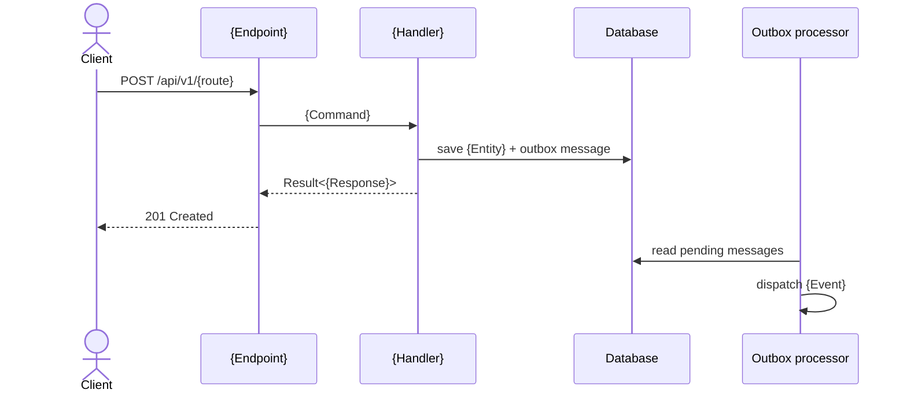

# Feature guide template

Copy this into `<DOCS_DIR>/features/<slug>.md` and replace every `{...}`. Delete any optional section (marked *optional*) that does not apply; keep the order of the rest.

````markdown
---
title: "How To {Do the Main Task} with {Feature Name}"
description: "{One sentence: what the reader will be able to do after reading.}"
slug: {slug}
tags: [{domain}, {feature area}, api]
applies_to: "{Product or API version, e.g. API v1}"
spec: {relative link to the spec}
last_updated: {YYYY-MM-DD}
last_validated: {YYYY-MM-DD | "not yet run against a live instance"}
---

# How To {Do the Main Task} with {Feature Name}

## Introduction

{Paragraph 1: what the feature is and the problem it solves, in terms of the reader's goal. Link the first mention of any concept the reader may not know.}

{Paragraph 2: how it fits with the rest of the system: the domain it belongs to, what it depends on, what happens as a result (events, notifications).}

In this guide, you will {list the outcomes of the steps in one sentence}. By the end, you will {the concrete result}.

> [!NOTE]
> **Compatibility:** {Version, environment or role this applies to. Optional: delete if there is nothing to say.}

## Key Takeaways

- **{Bold one-line fact}.** {One sentence of detail.}
- **{Who can call it}.** {Policy in plain words, e.g. "Only the account owner or staff can..."}
- **{What happens asynchronously}.** {Event or job, and that it is eventually consistent.}
- **{The most important limit or rule}.** {Rate limit, validation, soft delete...}

## Prerequisites

To follow this guide, you will need:

- {The API running locally. See [Running the API](../README.md#running-the-api) or `run-api`.}
- {An account or token with the `{PolicyName}` policy, and how to get one.}
- {Data that must exist first, with a link to the guide that creates it.}
- {Tools: `curl` and optionally `jq`.}

## Step 1 — {Gerund Phrase, e.g. Configuring Invoice Numbering}

{What this step does and why it is needed.}

**`{path/to/appsettings.Local.json}`**

```json
{
  "{Section}": {
    "{Option}": "<your-value>"
  }
}
```

{What each setting does, which ones are required, and the default if omitted.}

{Transition: "With X configured, you can now..."}

## Step 2 — {Creating a Resource}

{What and why.}

```bash
curl -s -X POST "{base-url}/api/v1/{route}" \
  -H "Authorization: Bearer <access-token>" \
  -H "Content-Type: application/json" \
  -d '{ "{field}": "{value}" }'
```

Replace `<access-token>` with {where it comes from}.

**Output**

```json
{
  "id": "3f2a…",
  "{field}": "{value}"
}
```

{What the response tells you: the status code, which fields to keep for the next step.}

> [!WARNING]
> {Anything that can lose data, cost money or affect other users. Optional.}

## Step N — {Verifying the Result}

{How to confirm the feature worked end to end: a read request, a log line, a UI screen, or the effect of an event.}

**Output**

```text
{expected output}
```

{What success looks like.}

## How It Works

{Two or three sentences, then the diagram. Show the real path: endpoint → validator → handler → DbContext → outbox → event handler.}



## Reference

### Endpoints

| Method | Route | Authorization | Rate limit | Success | Errors |
|---|---|---|---|---|---|
| POST | `/api/v1/{route}` | `{Policy}`: {plain words} | `{RateLimitPolicy}` | 201 | 400, 401, 403, 404, 409 |

### `{RequestType}`

| Field | Type | Required | Rules |
|---|---|---|---|
| `{field}` | `string` | yes | 1–200 characters |

### `{ResponseType}`

| Field | Type | Description |
|---|---|---|
| `id` | `Guid` | {…} |
| `createdAtUtc` | `DateTime` (UTC) | {…} |

### Errors

| Code | HTTP status | Message | When it happens |
|---|---|---|---|
| `{Entity}.NotFound` | 404 | {message} | {cause} |

### Domain events *(optional)*

| Event | Raised when | Handled by | Effect |
|---|---|---|---|

### Configuration *(optional)*

| Key | Type | Default | Description |
|---|---|---|---|

### Data model *(optional)*

| Entity | Property | Type | Notes |
|---|---|---|---|

Migration: `{MigrationName}`.

### User interface *(optional)*

| Page | Route | What the user does |
|---|---|---|

## Troubleshooting

### {Symptom the reader sees, e.g. "403 Forbidden when reading another customer's invoice"}

{Cause, then the fix.}

## FAQs

**{A question a reader would actually ask?}**
{Direct answer in one to three sentences.}

**{Another question?}**
{Answer.}

## Conclusion

In this guide, you {recap of what the reader did, in one or two sentences}. {What they can now build on.}

To go further:

- [{Related guide}]({relative link}) — {why to read it}.
- [{Related concept}]({link}) — {why}.
````
